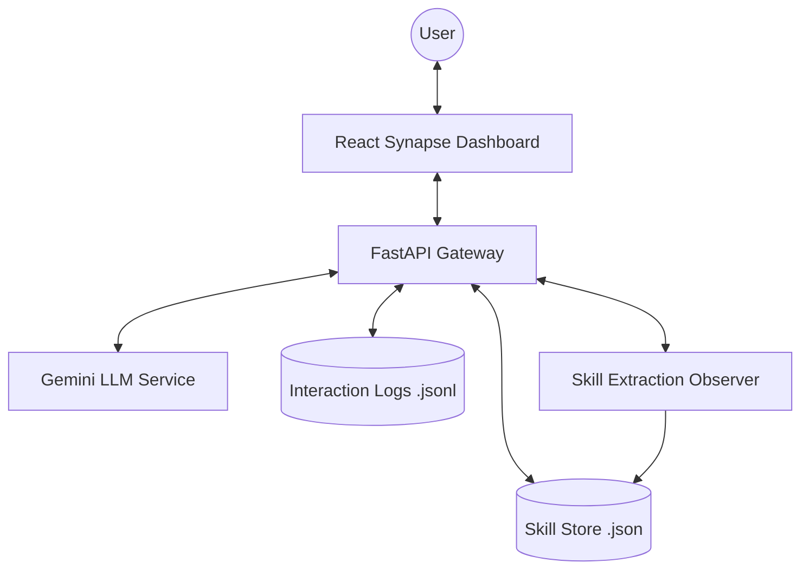

# 🧬 Kaushal AI (The Neural Monolith)

**Kaushal AI** is a state-of-the-art, cyberpunk-inspired neural monolith that bridges the gap between raw LLM intelligence and adaptive, skill-based automation. Built with a stunning interface and a high-performance Python backend, Kaushal AI dynamically learns from every interaction, distilling complex patterns into reusable "skills."

---

## ✨ Key Features

### 🧠 Adaptive Skill Extraction
The "Observer" logic continuously monitors chat history to identify repeatable workflows:
- **Pattern Recognition**: Automatically distills user intents into structured JSON skills.
- **Vector Search**: Uses high-dimensional embeddings (via Gemini) to match queries with active skills.
- **Human-in-the-Loop**: An intuitive analysis panel for approving and refining extracted skills.

### ⚡ Real-Time SSE Engine
Powered by **FastAPI**, the backend leverages Server-Sent Events (SSE) to stream:
- **Token-by-Token Responses**: Direct from Gemini LLMs.
- **Metadata Payloads**: Real-time skill matching scores and system status.
- **Persistence**: Interaction logs captured in high-performance `.jsonl` format.

---

## 🏗️ Architecture



---

## 🚀 Getting Started

### Prerequisites
- **Python 3.12+**
- **Node.js 20+**
- **MongoDB** (for advanced skill persistence)

### Installation

1. **Clone the Repository**
   ```bash
   git clone https://github.com/your-repo/kaushal-ai.git
   cd kaushal-ai
   ```

2. **Backend Setup**
   ```bash
   cd agent-skills
   pip install -r requirements.txt
   ```
   *Create a `.env` file:*
   ```env
   GEMINI_API_KEY=your_key_here
   ```

3. **Frontend Setup**
   ```bash
   cd ui
   npm install
   npm run build
   ```

### 🏃 Running the Monolith

Start the unified server from the `agent-skills` directory:
```bash
python3 api.py
```
Open [http://localhost:8000](http://localhost:8000) to enter the neural handshake.

---

## 📂 Project Structure

```text
.
├── agent-skills/              # Backend Core & API
│   ├── api.py                 # Unified FastAPI Gateway
│   ├── config.py              # Global settings and LLM configuration
│   ├── llm_service.py         # Gemini / LLM & Embedding Integration
│   ├── main.py                # Legacy CLI interface
│   ├── skills/                # Core Skill Logic (Extraction & Store)
│   ├── retrieval/             # Advanced Skill Search & Vector Retrieval
│   ├── memory/                # Interaction Logging & History
│   ├── benchmarking/          # Performance & Accuracy Tracking
│   ├── data/                  # Local persistence (JSONL/JSON)
│   └── ui/                    # React Frontend (Vite)
│       ├── src/               # UI components, state, and styles
│       ├── public/            # Static assets and icons
│       └── dist/              # Production optimized build
├── repository_overview.md     # Comprehensive architecture deep-dive
└── README.md                  # Project root overview
```


<div align="center">
  <sub>Built with ❤️ by the Kaushal AI Team</sub>
</div>
