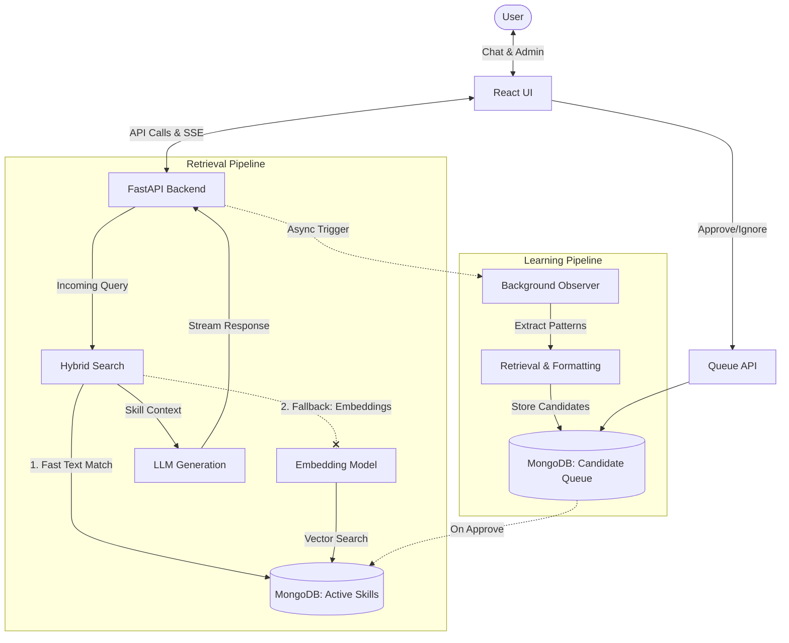

# Kaushal AI

Kaushal AI is an adaptive, agentic AI assistant designed to continuously learn and evolve from user interactions. Built with a robust FastAPI backend and a responsive React frontend, the system dynamically observes chat conversations, extracts recurring workflows or patterns, and queues them for human approval. Once approved, these highly specialized "skills" are stored in MongoDB.

During subsequent conversations, Kaushal AI uses a blazingly fast hybrid search mechanism—attempting a text match first, dynamically falling back to an LLM-based vector semantic search—to inject relevant capabilities into its generative context, effectively answering queries with learned expertise through Server-Sent Events (SSE) streaming.

## 🌟 Features

- **Hybrid Skill Retrieval:** Real-time search pipeline that implements deterministic text matching with a rapid fallback to embedding-based vector search for conceptual matching.
- **Continuous Learning Loop:** An asynchronous background Observer analyzes interaction logs and extracts structural candidates into an extraction queue without blocking the main event stream.
- **Queue Management UI:** A dedicated interface to review extracted skill candidates, allowing users to promote them to Active Skills or ignore them.
- **Server-Sent Events (SSE):** True real-time streaming of LLM tokens, skill matching events, and benchmarking data directly to the frontend.
- **Unified Architecture:** A single FastAPI server that acts as the backend api and serves the pre-built React frontend assets.
- **Performance Benchmarking:** Real-time telemetry tracking query latency, phase durations (text match, vector search, LLM generation), and cost evaluation.

## 🏗️ Architecture



## 📊 Empirical Benchmarks & Performance Results

All numbers below were measured directly on the codebase against live endpoints, real LLM calls, and local MongoDB storage. Full test harnesses, raw JSON logs, and analysis are recorded in [`benchmarks/RESULTS.md`](benchmarks/RESULTS.md).

| Metric | Measured Value | Sample Size / Conditions |
| :--- | :--- | :--- |
| **Local Retrieval Latency** | **0.294 ms** (Median) / **0.328 ms** (Mean) | $N = 400$ runs across 40 labeled queries, p95: 0.639 ms |
| **Out-of-Domain Rejection** | **100.0%** Noise Rejection | $N = 100$ runs across distractor queries (0 false positives) |
| **Prompt Token Reduction** | **96.3%** savings vs. catalog stuffing | Avg 17.6 tokens injected vs. 471 tokens baseline |
| **Semantic Recall Lift** | **46.7% $\to$ 90.0% (+43.3%)** | Lexical TF-IDF vs. 3072-dim Gemini vector embeddings |
| **LLM Generation Rate** | **213.9 tokens/sec** | Live `gemini-2.5-flash` streaming throughput |
| **LLM Time-To-First-Token** | **2,417 ms** (Mean) | Live raw network streaming TTFT |
| **Observer Extraction** | **100.0%** Success Rate (1,449 ms Mean) | Structured JSON signature extraction via Groq |
| **API Search Throughput** | **294.47 req/s** (p95: 28.32 ms) | `/api/skills/search` under concurrent load (0% errors) |
| **Candidate Queue API** | **277.71 req/s** (p95: 26.02 ms) | `/api/patterns/candidates` MongoDB cursor read |
| **Frontend Production Build** | **5.75 s** (Median) / **118.38 KB** gzip | React 19 + TypeScript 5.9.3 + Tailwind 4 (0 TS errors) |

### Reproduce Benchmarks

```bash
# Run hybrid retrieval & accuracy evaluation (400 runs)
python benchmarks/scripts/run_retrieval_bench.py

# Run Gemini vector embedding evaluation
python benchmarks/scripts/run_embedding_bench.py

# Run live LLM streaming throughput & TTFT evaluation
python benchmarks/scripts/run_llm_streaming_bench.py

# Run background Observer extraction & MongoDB storage benchmark
python -X utf8 benchmarks/scripts/run_observer_bench.py

# Run FastAPI endpoint throughput & latency benchmark
python benchmarks/scripts/run_api_bench.py

# Run frontend build duration & bundle size benchmark
python benchmarks/scripts/run_frontend_bench.py
```

## 📂 Project Structure

```text
.
├── api.py                     # Unified FastAPI Gateway & SSE streaming
├── config.py                  # Global settings, model configuration, and keys
├── llm_service.py             # Gemini & Groq LLM integration
├── main.py                    # Legacy CLI interface
├── skills/                    # Core Skill extraction, clustering, & MongoDB store
├── retrieval/                 # Hybrid skill search & vector retrieval
├── memory/                    # Interaction logging & session history
├── benchmarking/              # Real-time request telemetry tracker
├── benchmarks/                # Reproducible benchmark suite, raw outputs, and RESULTS.md
│   ├── eval_dataset.json      # 40 labeled technical evaluation queries
│   ├── scripts/               # Automated test runners
│   ├── raw_results/           # Raw unedited JSON execution telemetry
│   └── RESULTS.md             # In-depth benchmark analysis report
├── data/                      # Local JSONL persistence
└── ui/                        # React Frontend (Vite + TypeScript)
    ├── src/                   # Components, state, and styles
    └── dist/                  # Production-optimized build assets
```

## 🚀 Installation & Setup

### Prerequisites

- Python 3.12+
- Node.js & npm (for UI development)
- MongoDB instance (Local or Atlas)

### 1. Clone & Configure

Clone the repository and create an `.env` file in the root directory with your API keys and MongoDB connection string:

```env
GEMINI_API_KEY=your_gemini_api_key
GROQ_API_KEY=your_groq_api_key
MONGODB_URI=mongodb://localhost:27017
MONGO_URI=mongodb://localhost:27017
```

### 2. Install Backend Dependencies

Set up a virtual environment and install the required Python packages:

```bash
python -m venv venv
# Windows:
venv\Scripts\activate
# Unix/macOS:
source venv/bin/activate

pip install -r requirements.txt
```

### 3. Build the Frontend

Navigate to the UI directory to install dependencies and build the static assets:

```bash
cd ui
npm install
npm run build
cd ..
```

### 4. Run the Unified Server

Start the FastAPI application which serves both the API and the React frontend:

```bash
python api.py
```

1. Open your browser and navigate to **http://localhost:8000**
2. You will be greeted by the Kaushal AI dashboard.
3. Type your query into the terminal input at the bottom and watch the intelligence stream back with human-like typewriter delays!
4. Behind the scenes, the background Observer continuously extracts structural skills into the human-in-the-loop review queue.

---

<div align="center">
  <sub>Built with ❤️ by the Kaushal AI Team</sub>
</div>
